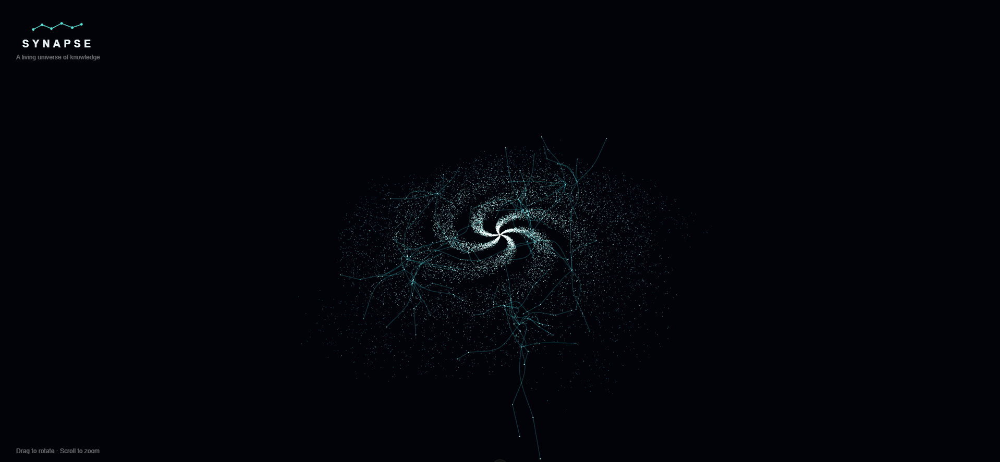

<div align="center">

# SYNAPSE

### Explore knowledge as a universe.

**An experimental, interactive 3D knowledge universe built with Nuxt, Vue, TypeScript, and Three.js.**

_From a procedural neural landscape to a navigable graph of connected ideas._


</div>

---

## The idea

What if exploring knowledge felt less like navigating a list of search results and more like traveling through a universe?

**SYNAPSE** is a personal exploration of that question. Its long-term vision is to represent topics as spatial nodes, relationships as connections, and related fields as constellations of ideas. Instead of treating knowledge as isolated pages, SYNAPSE aims to make its structure visible, interactive, and discoverable.

The project currently focuses on the **visual foundation**: a real-time 3D environment, procedural particle fields, and branching neural structures. The semantic knowledge graph and its interactions are the next development milestones—not completed features.

## Current preview

<!-- <details>
  <summary>View SYNAPSE preview</summary> -->

  
<!-- </details> -->

## What works today - v0.3

- **Real-time 3D scene** with a perspective camera, renderer, and orbit-based navigation.
- **Procedural particle field** containing approximately 15,000 particles, rendered using `THREE.Points` and `BufferGeometry`.
- **Neural structure generation** with curved branches created from `THREE.CatmullRomCurve3` and rendered as line segments.
- **Animation loop** using the modern `THREE.Timer` API.
- **Responsive canvas** with resize handling and lifecycle-aware resource cleanup.
- **Modular rendering systems**, keeping scene orchestration separate from individual visual effects.

The current version is a **visual prototype**, not yet a searchable or interactive knowledge database.

## Technology stack

| Layer              | Technology         | Role                                              |
| ------------------ | ------------------ | ------------------------------------------------- |
| Application        | **Nuxt 4**         | Application structure and development environment |
| UI                 | **Vue 3.5+**       | Component lifecycle and interface integration     |
| Language           | **TypeScript**     | Typed application and rendering code              |
| 3D rendering       | **Three.js**       | Scene, geometry, materials, camera, and animation |
| Styling            | **Tailwind CSS 4** | UI styling                                        |
| Animation          | **GSAP**           | Planned interface and transition animations       |
| Package management | **pnpm**           | Dependency management                             |

## Architecture

SYNAPSE separates the application interface from the 3D engine and divides rendering into independent systems.

```text
synapse/
├── app/
│   ├── components/
│   │   └── universe/
│   │       └── UniverseCanvas.client.vue
│   ├── pages/
│   │   └── index.vue
│   └── assets/
├── engine/
│   ├── core/
│   │   └── UniverseEngine.ts
│   └── systems/
│       ├── ParticleSystem.ts
│       └── NeuralStructureSystem.ts
├── nuxt.config.ts
└── package.json
```

**`UniverseCanvas.client.vue`** provides the browser-side integration point. **`UniverseEngine`** manages the Three.js scene, camera, renderer, controls, animation loop, resizing, and teardown. Individual systems own their geometry, materials, and visual behavior.

This structure is designed to support future additions - such as semantic nodes, graph edges, selection, and visual effects - without turning the main rendering loop into one large component.

### Rendering decisions

**Buffer-based rendering.** Particle positions and neural line segments are stored in buffer geometry rather than represented by thousands of independent scene objects.

**Shared resources.** Geometry and materials are reused where appropriate to reduce unnecessary allocations.

**Explicit cleanup.** Rendering systems dispose of GPU-related resources and the engine releases controls and renderer resources when the canvas is unmounted.

**Client-only canvas.** The WebGL environment is initialized in a Nuxt client component, respecting the boundary between server rendering and browser APIs.

These choices establish a foundation for scaling the scene, although performance benchmarks and profiling are still future work.

## Roadmap

| Milestone  | Focus                                                                                    | Status      |
| ---------- | ---------------------------------------------------------------------------------------- | ----------- |
| **v0.1**   | Three.js engine, camera, controls, lifecycle                                             | Complete    |
| **v0.2**   | Procedural particle universe                                                             | Complete    |
| **v0.3**   | Organic neural structures                                                                | Complete    |
| **v0.4**   | Semantic knowledge nodes, relationships, and clusters                                    | Planned     |
| **v0.5**   | Hover, selection, and topic detail interactions                                          | Planned     |
| **Future** | External knowledge sources, richer exploration, visual polish, and performance profiling | Exploration |

### Long-term direction

The goal is to evolve from a procedural visual environment into an exploratory interface where users can:

1. Discover subjects through spatial navigation.
2. Follow meaningful connections between ideas.
3. Understand how disciplines overlap through clusters and relationships.
4. Open contextual information about selected topics.
5. Explore knowledge drawn from real-world sources, potentially including Wikidata, Wikipedia, and OpenAlex.

These are product goals, not claims about the current implementation.

## Getting started

### Prerequisites

- A recent Node.js version compatible with the project's Nuxt release
- **pnpm**
- A browser with WebGL support

### Run locally

```bash
pnpm install
pnpm dev
```

Open the local URL printed by Nuxt in your terminal (typically `http://localhost:3000`).

For a production build:

```bash
pnpm build
pnpm preview
```

## What I'm learning and exploring

SYNAPSE is also a hands-on engineering project focused on understanding the rendering pipeline rather than treating 3D as a black box.

Areas of particular interest include:

- Procedural geometry and vector mathematics
- GPU-friendly rendering with buffer attributes
- Scene organization and resource lifecycles
- Recursive and branching structures
- Graph data modeling and spatial visualization
- Interaction design for complex information spaces
- Performance trade-offs as visual complexity grows

## Project philosophy

**Build the foundation, understand the trade-offs, then scale.**

The project is developed incrementally: each milestone introduces a small set of concepts, validates them in a working scene, and prepares the architecture for the next layer. Visual experimentation is part of the process, but the longer-term objective is a meaningful, usable knowledge exploration experience.

## Status

SYNAPSE is an **independent project in active development**. APIs, visual language, and architecture may evolve as new milestones are implemented.

---

<div align="center">

**SYNAPSE — connecting ideas in three dimensions.**

</div>
